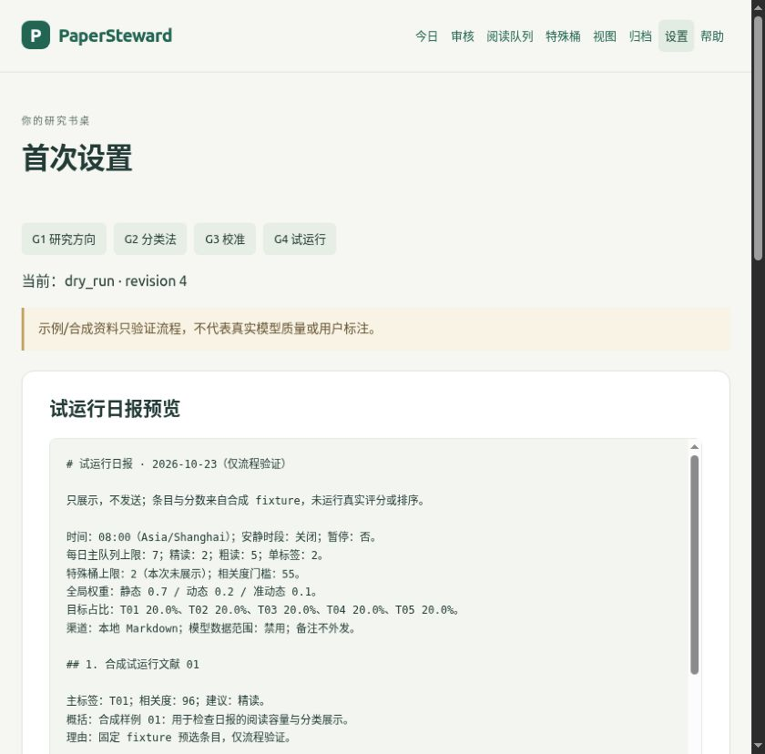

# PaperSteward

每天挑几篇值得读的论文，读完留下自己的判断。

PaperSteward 是单用户、本地优先的文献阅读工具：采集 arXiv、OpenAlex、Semantic Scholar，生成概括与分类，按研究方向安排阅读队列，记录评分、备注和归档。浏览器完成首次设置和日常操作。

当前为 Beta。示例资料可离线体验完整设置与试运行日报；真实论文处理需要配置兼容模型并明确授权。



## 启动

选择 Docker Compose 或 Python 3.11+。首次安装依赖需要联网。

**Docker**

```bash
git clone https://github.com/INKEM/PaperSteward.git
cd PaperSteward
docker compose up --build
```

打开 [首次设置](http://127.0.0.1:8000/ui/setup)。启动会显式迁移数据库，数据保存在命名卷中。`docker compose down` 停止并保留数据；不要加 `-v`。

**Python / pipx**

在已安装 pipx 的环境中：

```bash
git clone https://github.com/INKEM/PaperSteward.git
cd PaperSteward
pipx install .
papersteward start --data-dir ./var
```

也可用虚拟环境：

```bash
python3 -m venv .venv
.venv/bin/python -m pip install .
.venv/bin/papersteward start --data-dir ./var
```

`start` 显式迁移后启动服务并自动打开浏览器；`--no-browser` 关闭自动打开，`--port 8001` 换端口。当前使用源码或自行构建的 wheel，不要求 PyPI 已发布。详细步骤见[快速开始](docs/quickstart.md)。

## 第一次打开

1. **研究方向**：编辑或保留 Starter，保存草稿，审阅全文后明确确认。
2. **分类法**：审阅分类与种子分布，再确认。
3. **校准**：先用示例生成报告，审阅指标和分歧，再确认。
4. **试运行**：调整阅读参数，预览合成日报，记录认可反馈，再确认完成。

安装完成后，Starter 路径通常几分钟可看到试运行日报。它明确标注“合成 / 仅流程验证”，不代表真实模型质量。正式使用请用自己的资料在新工作区重新确认；[模型配置](docs/llm-provider.md)和数据授权都就绪后才能处理真实论文。

## 每天怎么用

在“今日”页点击 **同步 / 处理**，检查来源、检索词、上限并授权本次访问；随后 **处理审核 → 生成日报 → 阅读并记录反馈**。运行进度会保存，关闭页面后可回来查看；失败时保留已完成数据，检查原因后显式重试。

阅读队列可查看评分解释；特殊桶浏览综述、远邻和经典；自定义视图按自己的偏好重排。读完的论文可搜索，并导出 BibTeX、CSV、Markdown 或 JSON。邮件只通过显式 CLI 操作发送。

## 配置与帮助

- [配置与工作区](docs/configuration.md)、[模型接入](docs/llm-provider.md)
- [隐私与数据流向](docs/privacy.md)、[排障](docs/troubleshooting.md)、[常见问题](docs/faq.md)
- 高级用法：[初始化 CLI](docs/advanced/onboarding-cli.md)、[采集](docs/advanced/ingestion-cli.md)、[处理与审核](docs/advanced/process-review-cli.md)、[日报与归档](docs/advanced/delivery-cli.md)
- [评分解释](docs/advanced/priority-queue.md)、[特殊桶](docs/advanced/shelves.md)、[排序视图](docs/advanced/views.md)、[全局权重变更](docs/advanced/config-governance.md)

默认绑定 `127.0.0.1`，阅读数据保存在本地，备注不发送到模型，没有遥测或外部 CDN。模型处理会按授权发送论文元数据和摘要。没有多用户登录、PDF 全文解析或笔记软件同步。

[MIT 许可证](LICENSE)。内置 HTMX 保留其 [0BSD 许可证](src/papersteward/static/HTMX-LICENSE)。
