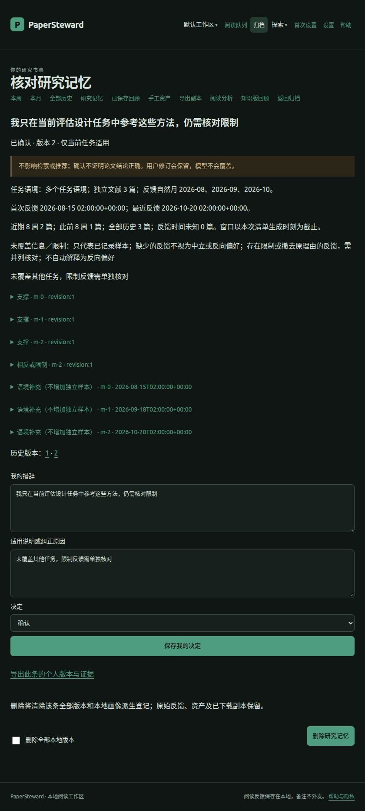

# R2-06 浏览器走查记录（2026-10-27）

走查对象：`feat/reading-insights-phase2` 上 R2-06 长期研究记忆与画像候选。
临时工作区保存合成阅读、评分、结构化理由与资产；模型端点指向本机假
OpenAI 兼容服务，浏览器全程未访问外网，未触碰用户个人数据库。

| 场景 | 操作 | 结果 |
|---|---|---|
| 入口 | 全部历史 → 研究记忆 | 页面分为长期价值标准候选、近期兴趣与任务线索、知识资产与开放问题；顶部说明仅用于回顾，不参与检索、排序、入队或研究档案 |
| 材料预览（不发送） | 勾选冻结元数据、评分、结构化理由，提交预览 | 显示清单版本锚点、覆盖／省略计数、校验哈希与预览令牌；假端点调用次数仍为零 |
| 仅本次授权 | 选择「仅本次清单」并确认数据去向 | 授权页保留预览令牌和已选类别，可直接按原清单提交；未重新预览不会生成新授权 |
| 分析运行 | 提交清单 | 后台任务经真实 HTTP 发送到本机假端点；完成后跳回研究记忆，候选为「待确认」，未写入研究档案 |
| 候选核对 | 打开条目详情 | 并列支撑、相反或限制、语境补充材料；显示独立文献数、反馈自然月、近期 8 周／此前 8 周／全部历史窗口、未覆盖信息及三类时间 |
| 用户决定（键盘） | 不改默认控件，直接编辑措辞、选择「仅本次任务适用」并提交 | 303 回条目详情，显示「已确认 · 仅当前任务适用」；用户措辞与决定形成新版本，旧版本仍可逐版打开 |
| 反馈与资产查找 | 关键词、资产类型、记录时期组合筛选 | 研究记忆按实际反馈时间筛选；知识资产先按记录时期过滤再限制展示条数，较早资产不会被前 200 条新资产遮住 |
| 来源治理 | 撤回研究记忆授权后重新打开条目 | 显示需复核与来源问题，停止使用；本地措辞保留，可删除全部版本。资产删除预览会列出相关画像 |
| 窄屏 | 研究记忆列表、预览、授权、条目详情 | 表单与证据段落换行，无横向溢出；截图见下 |

## 环境限制（如实记录）

- 模型调用全部指向本机假端点，未使用真实外部模型；没有把真实私人备注
  作为走查材料。
- Docker、其他设备实机与真实打印未执行。生产个人库未改动；空库迁移往返
  与带数据 0031↔0032 往返由自动化测试覆盖。
- 页面交互同时由 `tests/integration/test_reading_memory.py` 的浏览器表单、
  JSON、后台任务与来源撤回用例复核；本记录不替代 R2-07 的发布级浏览器
  全量验收。
